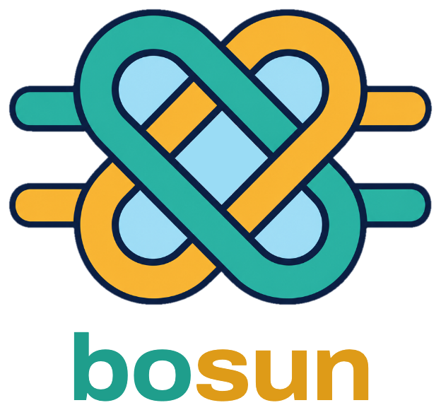
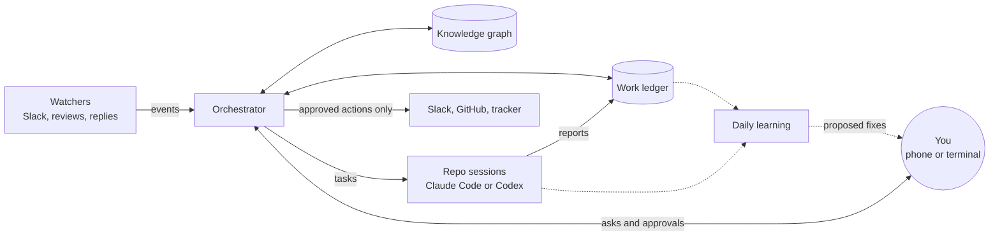

<p align="center">
  
</p>

<p align="center">
  <strong>Agents write the code. Bosun runs the rest of the day, and remembers it.</strong>
</p>

On a ship, the bosun runs the deck crew and the day's work so the captain can steer. This bosun
runs a fleet of coding agents (Claude Code and Codex) and the work around the code: reviews,
follow-ups, hand-offs and the people you are waiting on. Everything it handles becomes a
structured record: a work ledger of what is in flight, and a knowledge graph of how your
organization actually works, sourced, reviewed and improved every day. People and their agents
start from what the organization already knows, instead of finding it out again.

## Why bosun

- **Proactive, not prompted.** Bosun does not wait for you to push it. Cheap watchers notice new
  Slack mentions, review requests and replies; the orchestrator triages them, hands each task to
  the right repo session and checks in hourly, asking you only what needs you.
- **A structured work ledger.** Every ask, task, pull request, ticket and person you are waiting on
  is a typed item with a state machine and evidence rules: work cannot be marked done on a guess,
  and nothing silently drops between days, sessions or people.
- **Organizational knowledge that compounds.** A knowledge graph keeps how things are done here:
  processes, owners, decisions, environments, lessons. Each fact carries its source and authority,
  and you confirm facts in short review batches, so agents work from knowledge you trust rather
  than from a guess or a stale wiki page.
- **Continuous learning.** Every evening bosun reads the day's sessions and the ledger, finds what
  went wrong (a stalled task, a duplicate message, a rule that was missing) and proposes the fix,
  quoting its evidence. You approve what it learns.
- **You stay in command.** Nothing goes out under your name, whether a Slack reply, a merge or a
  ticket change, until you have approved that exact action. Approve in one line, from your phone.
- **Built to be shared.** The waste that costs most sits between people: context explained again,
  hand-offs dropped, a lesson one team learned that another has to learn again. Bosun's ledger and
  knowledge graph are records a whole organization can build on, so every engineer and every agent
  works from the same picture. Today they serve one engineer; sharing them across a team is next
  on the [roadmap](ROADMAP.md).

## How it works



The orchestrator and one agent session per repository run in tmux on your Mac. Claude Code sessions
can be resumed from your phone with Remote Control. A watchdog checks every five minutes that all of
it is alive, and a local console shows the ledger, the sessions, the knowledge base and what
bosun did for you.

## A day with bosun

- **08:00.** Your Mac wakes, logins are refreshed and every repo session resumes where it stopped.
- **Morning.** The orchestrator reads Slack, your pull requests and the reviews you were asked
  for, records each in the ledger and hands the work to the right session.
- **All day.** Watchers turn new mentions and replies into events; repo sessions report back;
  the orchestrator chases the people you are waiting on and checks in every hour.
- **When something would go out.** You get one line to approve: this message, to this person,
  in this thread.
- **18:30.** Learning reviews the day and proposes fixes; new facts about how things work wait
  for your review.

## Quick start

On a Mac:

```bash
curl -fsSL https://raw.githubusercontent.com/promptromp/bosun/main/get.sh | sh
```

You need macOS, [Homebrew](https://brew.sh) and [Claude Code](https://claude.com/claude-code). If
anything is missing, it says what, gives you the lines to run, and stops; run the same line again once
they are done. Then it asks a few questions, one key each. Bosun works out your repos and hours from how
you already use your agents and recommends a setup; nothing changes until you have seen the plan, and it
asks for `sudo` once, for the wake schedule.

To run the repo sessions on [Codex](https://developers.openai.com/codex/cli), with the orchestrator on
Claude Code, end the line with `| BOSUN_HARNESS=codex sh`, or pick it in the questions if Codex is already
installed and logged in. See [Running repo sessions on Codex](docs/setup.md#running-repo-sessions-on-codex).

Prefer to look first? [`get.sh`](get.sh) is short, and `sh -s -- --dry-run` after the pipe says what it
would do. [Setup](docs/setup.md) covers the details: other ways to install, configuration and logins.

## Status

- **macOS only** (launchd, `pmset`, `caffeinate`) for now. Linux is next, and the installer's checks are
  already split by OS so it can follow.
- **Claude Code and Codex** both run repo sessions, window by window. The orchestrator needs Claude Code,
  and Codex windows do not have everything yet: see
  [what they lack](docs/design/harnesses.md#what-codex-windows-do-not-have-yet).
- **One engineer, one Mac** today. A ledger and knowledge base shared across a team is next.
- **The proactive parts are opt-in** while they mature: events and the Slack watcher, approvals
  and learning are each switched on in `bosun.env` ([Setup](docs/setup.md#configuration)).

## Documentation

| Guide | What it covers |
|---|---|
| [Setup](docs/setup.md) | Requirements, install, configuration, sessions, Codex, Claude Code login, AWS SSO |
| [Commands](docs/commands.md) | Every `bosun` command |
| [Orchestrator](docs/orchestrator.md) | Chores, delegated tasks, the ledger, outreach, tasks, tickets, workstreams |
| [Permissions](docs/permissions.md) | What needs your approval, and approvals bound to the exact call |
| [Events](docs/events.md) | Events from repo sessions and the Slack watcher |
| [Knowledge](docs/knowledge.md) | The organizational knowledge graph |
| [Learning](docs/learning.md) | The daily learning run |
| [Watchdog](docs/watchdog.md) | Health checks and alerts |
| [Console](docs/console.md) | The local web console and the Impact view |
| [Development](docs/development.md) | Working on bosun, and testing without waiting for the schedule |
| [Known limits](docs/limits.md) | What bosun does not do yet |

Design notes for each part are in [docs/design](docs/design/), and what comes next is in the
[roadmap](ROADMAP.md).

## Contributing

Issues and pull requests are welcome: see [CONTRIBUTING.md](CONTRIBUTING.md) and the
[code of conduct](CODE_OF_CONDUCT.md). Report security problems privately, as
[SECURITY.md](SECURITY.md) describes.
