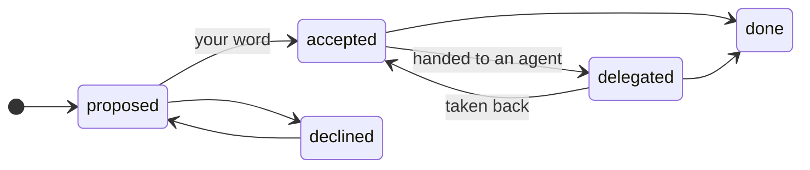
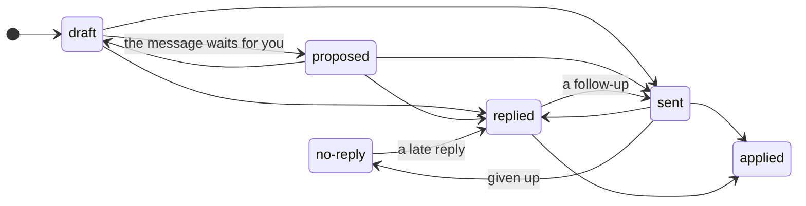

# The ledger

The ledger is bosun's record of every piece of work: each ask, task, pull request, review, question
and ticket. Each one is an item with an id, a state and a history, and links that say where it came
from and what came of it. The orchestrator and the repo agents change it only through bosun's own
commands, and those check every change against the item's rules.

You rarely touch it yourself. You tell the orchestrator what you want in your own words, and the
console and `bosun ledger list` show you where everything stands.

## Why a ledger

- **Nothing drops between days, agents or people.** The orchestrator starts a fresh conversation each
  morning. What was in flight is in the ledger, not in yesterday's chat.
- **Nothing is marked done on a guess.** The moves that matter need evidence: your words, a link to the
  reply, a new review request.
- **Nothing is handled twice.** Every Slack message bosun has processed is recorded by its link, so a
  message still in tomorrow's search is recognised and skipped.
- **Work and the trackers stay in step.** Jira and GitHub issues are mirrored, and bosun tells you where
  a ticket and the work disagree.

## What goes in it

Every item has a kind, and its id says what it is:

| Kind | Its id | What it is |
|---|---|---|
| Review request | `review:<owner>/<repo>#<n>` | Someone asked you to review their pull request |
| Tech design review | `td:<page-id>` | Someone asked you to review a tech design |
| Your pull request | `mypr:<owner>/<repo>#<n>` | Your own pull request, followed until it is merged or closed |
| Mention | `slack:<channel>/<ts>` | Any other Slack mention that may need you |
| Task | `task:<YYYY-MM-DD>/<id>` | Work we decided to do that has no pull request or page of its own yet |
| Outreach | `out:<parent-id>/<id>` | Something we asked someone, and wait on |
| Ticket | `jira:<KEY>-<n>`, `ghissue:<owner>/<repo>#<n>` | An issue in your tracker, mirrored read-only |
| Workstream | `ws:<slug>` | A time-bound effort that groups items, such as "Widget search" |
| Learning | `learn:<YYYY-MM-DD>/<id>` | A fix the evening learning run proposes |

The `<id>` in a task, outreach or learning id is six characters such as `7k2m9q`, made so that two Macs
never make the same one. `bosun ledger kinds` prints every kind with its states and rules.

## Each item moves through states

Every kind has its own state machine, and a move it does not allow is refused. A task, for example:

A task starts as `proposed`. It is `accepted` only on your word, `delegated` when bosun hands it to the
agent working in that repository, and `done` when what it produced has landed or its report answered
the ask. From any state it can be `dropped`, with a note that says why.

Outreach, something we asked and wait on, has a state machine of its own:

`applied` means the reply reached the work that waited on it. `no-reply` is giving up after the last
nudge, and a late reply still counts.

## Rules that keep it honest

- **Only your word accepts work.** A task becomes `accepted` only with what you said as its evidence
  (`user: go ahead`). A colleague's message never accepts work: their request becomes a proposal that
  waits for you.
- **A reply needs proof.** Recording a reply needs a reference to it: a Slack link, an email's message id,
  a comment's URL.
- **A re-review needs a new request.** Moving a review you already did back to `rereview-requested`
  needs a request made after your review. An old message that is still in the search doesn't count.
- **Work that waits on someone stays open.** An item can't finish while a question it asked is still
  open, unless the note says why. A pull request that merged or closed is a fact, not a choice, so that
  goes through, and the note names the question still open.
- **Every change is kept.** Each item keeps its history: what moved, when, why and on what evidence.

## Links: where work came from and what came of it

Items are linked, so a piece of work carries its story with it. A link is stored once and read both
ways:

| Link | Means |
|---|---|
| `spawned_from` | This item came from that one, with the message that asked |
| `produces` | This item's work produced that one, such as a task's pull request |
| `tracks` | That ticket tracks this item |
| `blocked_by` | This item can't finish while that one is open |
| `duplicate_of` | The same item twice; the other carries it on |
| `folded_into` | This item's work goes on as part of that one, for example in its pull request |
| `part_of` | This item belongs to that workstream |
| `relates_to` | Loosely related |

Here is one ask and everything that came of it, from the example on the [home page](index.md):

- **A Slack mention:** Priya asks "could you also export credit notes?"
  - **A task,** spawned from her message: export credit notes. You said "go ahead", so it is accepted
    and handed to the exporter's agent.
    - **A pull request** it produced, waiting for review.
    - **A Jira ticket** that tracks it, which says Done. Bosun flags that, since the pull request is
      still open.
    - **A question** to Dana about credit-note numbering. Until her reply is handed over, the task
      can't finish.
  - **Two more tasks** from the same thread: one the same as the first (`duplicate_of`), one small
    enough to be done in the same pull request (`folded_into`). Both are closed, and both point at
    the task that carries them on.

`bosun ledger tree <id>` shows this for any item, with each item's state.

## How new work is spawned

Work that has no pull request or page of its own yet is a task, spawned from the item it came from, so
its origin is a link rather than a note:

- Tell the orchestrator "go ahead and do it" about a reply or a mention, and it spawns the task with
  your words, accepts it and hands it to the right agent.
- A colleague's request becomes a proposed task that waits for you under *Needs your approval*.
- Repo agents spawn the follow-ups they find, and never start them on their own.
- A request made twice is closed as a duplicate of the first, and a small ask done inside a bigger one
  is folded into it. Both keep the link.

## Jira and GitHub issues

A Jira issue or GitHub issue that tracks your work is a ticket item, such as `jira:EXP-123`. Tell the
orchestrator "this pull request is for EXP-123" and it links them. It reads the ticket with your
tracker's own tools and records what it saw. Bosun never changes a ticket itself.

A ticket's state is a category: `todo`, `in-progress`, `in-review`, `done` or `cancelled`. Where a
ticket and the work disagree, bosun proposes the exact change for you to make: a ticket closed while
the work is open, still open after the pull request merged, still `todo` while the pull request is in
review. For another team's projects it only tells you. Status names your tracker uses and the projects
that are yours go in `bosun.env`; the [Orchestrator guide](orchestrator.md#external-tickets) has the
settings.

## Handing work to an agent, and hearing back

`bosun delegate` hands an item to a repo agent and records which window has it. The agent reports back
with `bosun ledger report`: what it did, the pull request or file it produced, and what is still open.
So no step depends on a chat history or on what a window happens to show, and `bosun ledger list`
shows which window has each item until it reports.

## Workstreams

A workstream groups the items of one effort for a weekly stand-up and for stats. Put the first item in
it, and what came from that item follows. `bosun ledger summary --ws <ws>` drafts the stand-up: what
shipped, what is in review and with whom, what waits on others, and what is next.
[Workstreams](orchestrator.md#workstreams-what-an-item-is-for) has the details.

## How it is kept

Every change is first written to a journal, and `ledger.json` is rebuilt from it. Writes take a lock,
and a write cut short is finished by the next one, so a crash never leaves half a change behind.
`bosun ledger validate` checks every rule, and `bosun doctor` runs it for you.
[Sync and sharing](design/sync.md) explains the journal, which is also what will let a team share one
ledger.

## Commands you will see

You rarely type these. The orchestrator and the agents use them, and they are handy for a look:

| Command | Shows |
|---|---|
| `bosun ledger list` | Open items, with their state and what each waits on |
| `bosun ledger show <id>` | One item: its fields, history and links |
| `bosun ledger tree <id>` | Where an item came from and what came of it |
| `bosun ledger kinds` | Every kind, with its states and rules |
| `bosun ledger tickets --mismatch` | Where tickets and the work disagree |
| `bosun ledger summary --ws <ws>` | A stand-up draft for one workstream |
| `bosun ledger validate` | Every rule checked, with what to do about a finding |

The [Orchestrator guide](orchestrator.md#ledger-idempotency-and-state) describes every field and command
in full, and [Work-item lineage](design/lineage.md) is the design behind the links.
